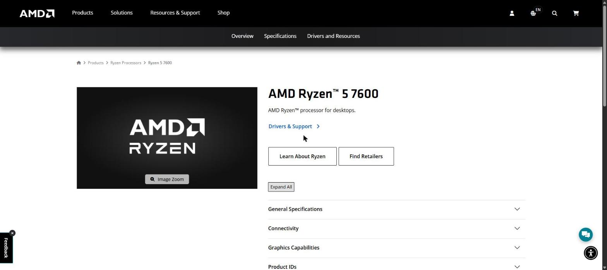
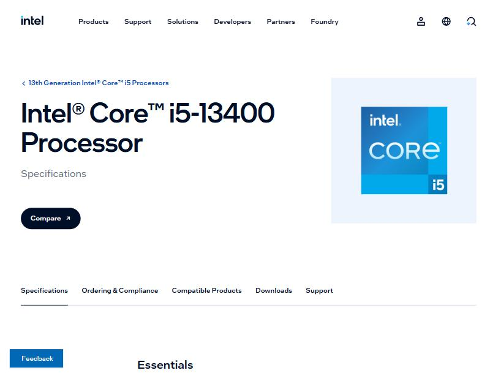
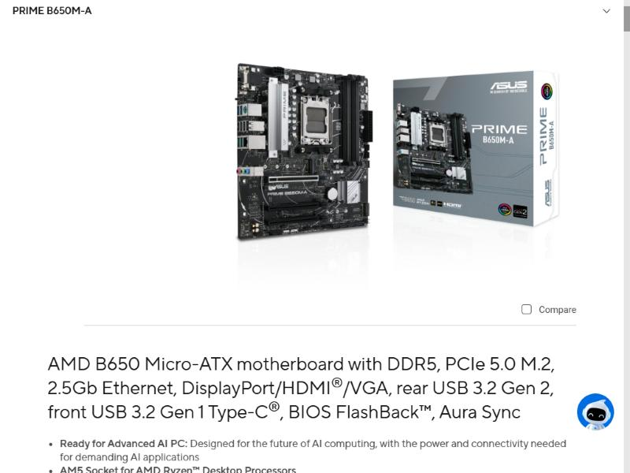
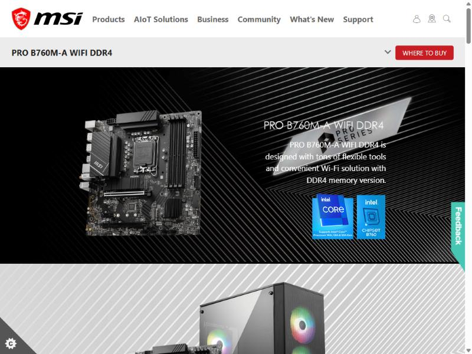
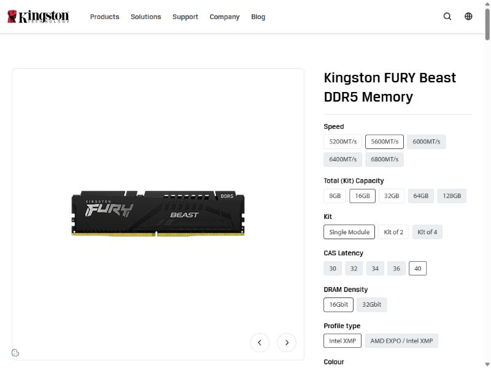
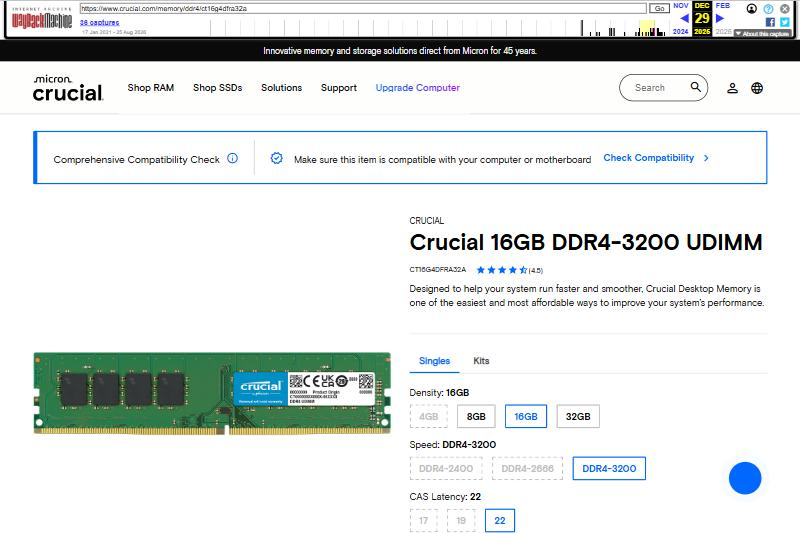
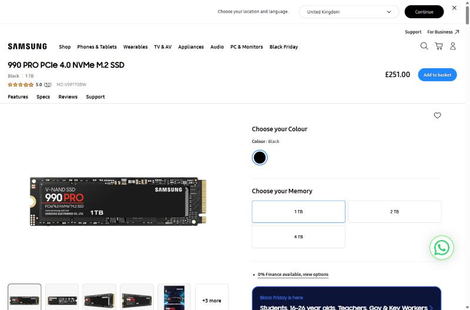
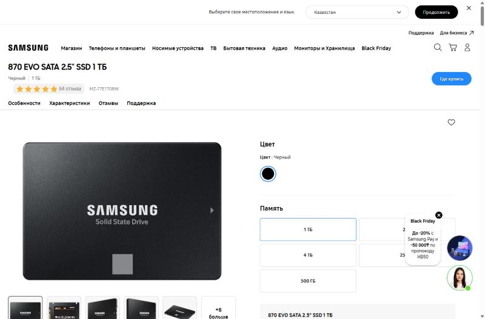
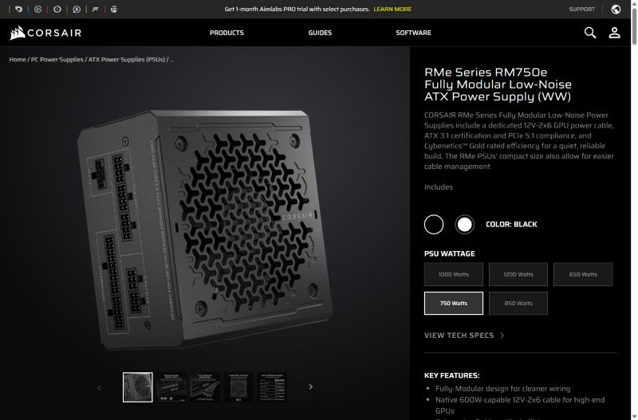
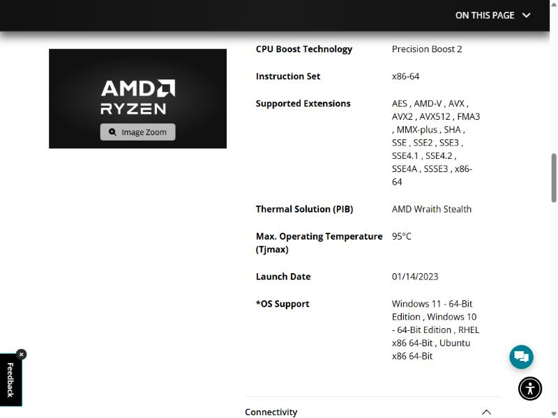

# Lab 3 — Teardown, and the same machine from the command line

Pair: Yermukhan / Imanbayeva  Driver first half: Yermukhan
Machine: MACHCREATOR L16A laptop (AMD Ryzen 7 7735HS with Radeon Graphics, 16 GB RAM, 1 TB SSD, Windows 11 Pro, build 26200) — physical host;
Ubuntu Server 26.04.1 LTS guest in VirtualBox on the same laptop (2 vCPU, 2 GB RAM, 25 GB disk, NAT)
Date: 04.11.2026

## What I did

**First half — teardown on paper.** For each of the ten parts in the Canvas list I opened the maker's own
page (not a shop page), wrote down what the part is, what it connects to and what limits it, saved a
screenshot of the maker's photo into [`evidence/photos/`](evidence/photos/) and kept the link. For the two
motherboards I took socket, chipset, memory type and the CPU list from the boards' spec pages. Then I
matched the parts into two computers by socket → chipset → memory type → storage interface → power.

**Second half — the same facts from the command line.** I ran the same questions (CPU model, cores,
threads, RAM total and modules, disk model/type/size/free space) on Windows and on Linux. Each script
prints the command right before its raw output, so every number in the evidence file sits next to the
command that produced it.

Windows (PowerShell, on the laptop itself — the host, not a VM):

```powershell
cd labs\lab03-teardown\scripts
powershell -ExecutionPolicy Bypass -File .\collect-windows-specs.ps1 -OutFile ..\evidence\windows-specs.txt
```

Linux (inside the Ubuntu Server VM). The VM is on NAT, so I added a VirtualBox port-forward
(host 127.0.0.1:2222 → guest 22) and drove it from Windows over SSH — copy the script in, run it,
copy the result back:

```powershell
cd labs\lab03-teardown
scp -P 2222 scripts\collect-linux-specs.sh yasmina@127.0.0.1:~/
ssh -t -p 2222 yasmina@127.0.0.1 "bash ~/collect-linux-specs.sh ~/linux-specs.txt"   # sudo asks for the password once
scp -P 2222 yasmina@127.0.0.1:~/linux-specs.txt evidence\linux-specs.txt
```

macOS — script is ready ([`scripts/collect-macos-specs.sh`](scripts/collect-macos-specs.sh)) but
nobody in the pair has a Mac, so the macOS column is the commands only, with no output.

## Result

### 1. The ten parts

Every caption follows the same pattern: **what it is · what it connects to · what limits it.**

#### 1.1 AMD Ryzen 5 7600 — processor


Desktop CPU, Zen 4 ("Raphael"), 6 cores / 12 threads, 3.8 GHz base, up to 5.1 GHz boost, 6 MB L2 + 32 MB L3,
65 W TDP, integrated AMD Radeon Graphics (2 graphics cores, 2200 MHz). Boxed product ID 100-100001015BOX.
**Connects to:** socket AM5 — AMD lists A620, B650, B650E, X670, X670E, B840, B850, X870, X870E boards;
two channels of DDR5 UDIMM; PCIe 5.0 (24 usable lanes).
**Limits:** DDR5 only — there is no DDR4 on AM5. Official memory speed DDR5-5200 with two modules
(2×1R or 2×2R), only DDR5-3600 with four; 128 GB max; Tjmax 95 °C.
Maker's page: <https://www.amd.com/en/products/processors/desktops/ryzen/7000-series/amd-ryzen-5-7600.html>

#### 1.2 Intel Core i5-13400 — processor


13th-gen ("Raptor Lake") desktop CPU, 10 cores (6 Performance + 4 Efficient), 16 threads,
P-cores 2.5 → 4.6 GHz, E-cores 1.8 → 3.3 GHz, 20 MB Intel Smart Cache, Intel UHD Graphics 730.
**Connects to:** FCLGA1700 socket; two memory channels, either DDR4 **or** DDR5 — the motherboard decides
which; PCIe 5.0 and 4.0, 20 lanes (1×16 + 4).
**Limits:** Processor Base Power 65 W but Maximum Turbo Power 148 W (matters for the PSU and cooler);
memory up to DDR5-4800 or DDR4-3200; 192 GB max; Tjunction 100 °C.
Maker's page: <https://www.intel.com/content/www/us/en/products/sku/230495/intel-core-i513400-processor-20m-cache-up-to-4-60-ghz/specifications.html>

#### 1.3 ASUS PRIME B650M-A — motherboard


Micro-ATX board (24.4 × 24.4 cm), socket AM5, AMD B650 chipset, 4 × DDR5 DIMM, dual channel.
**Connects to:** AMD Ryzen 7000/8000/9000 desktop CPUs up to 170 W; DDR5 UDIMM 4800/5000/5200, up to
5600 with EXPO (OC); 2 × M.2 Key-M — M.2_1 from the CPU (PCIe 5.0 x4 with Ryzen 7000/9000), M.2_2 from
the chipset (PCIe 4.0 x4) — plus 4 × SATA 6 Gb/s; 1 × PCIe 4.0 x16 slot for a graphics card; DisplayPort,
HDMI and VGA outputs (work only with a CPU that has graphics); PSU via 24-pin ATX + 8-pin +12V.
**Limits:** AMD AM5 CPUs and DDR5 only; micro-ATX; this base model has no Wi-Fi (the "WIFI" variant does);
with a Ryzen 8000 CPU the x16 slot drops to x8/x4 and M.2_1 to PCIe 4.0.
Maker's page: <https://www.asus.com/motherboards-components/motherboards/prime/prime-b650m-a/techspec/>

#### 1.4 MSI PRO B760M-A WIFI DDR4 — motherboard


Micro-ATX board (243.84 × 243.84 mm), socket LGA 1700, Intel B760 chipset, 4 × DDR4 DIMM, Intel Wi-Fi 6E +
Bluetooth 5.3, Realtek 2.5G LAN.
**Connects to:** Intel Core 12th/13th/14th Gen, Pentium Gold and Celeron; DDR4 non-ECC unbuffered, 2133–3200
(JEDEC), up to 5333 with XMP (OC), max 128 GB; 2 × M.2 — M.2_1 from the CPU (PCIe 4.0 x4), M.2_2 from the
chipset (PCIe 4.0 x4 or SATA) — plus 4 × SATA 6G; PCI_E1 PCIe 4.0 x16 for a graphics card; 2 × HDMI 2.1 and
2 × DisplayPort 1.4 (only with a CPU that has graphics); PSU via 1 × ATX_PWR (24-pin) + 2 × CPU_PWR.
**Limits:** DDR4 only — the same board without "DDR4" in the name is the DDR5 version, and the two are not
interchangeable; Intel LGA 1700 only; one SATA port is disabled when an M.2 SATA SSD sits in M2_2.
Maker's page: <https://www.msi.com/Motherboard/PRO-B760M-A-WIFI-DDR4/Specification>

#### 1.5 Kingston FURY Beast DDR5-5600 16 GB (KF556C40BB-16) — memory


One 16 GB DDR5 desktop DIMM, 288 pins, single rank (1Rx8, eight 2G×8 chips), 5600 MT/s CL40-40-40 at
1.25 V through its Intel XMP 3.0 profile; without a profile it runs as JEDEC DDR5-4800 CL40 at 1.1 V.
On-die ECC and an on-module power chip (PMIC), as on every DDR5 DIMM.
**Connects to:** a DDR5 DIMM slot — here the ASUS PRIME B650M-A. One module fills one of the CPU's two
memory channels.
**Limits:** DDR5 boards only (the key notch is in a different place from DDR4, so it physically won't go in
the MSI board). On the Ryzen 5 7600 AMD's official maximum is DDR5-5200, so 5600 is an overclock; this
part number carries an Intel XMP profile — Kingston also sells an AMD EXPO version of the same kit
(KF556C36BBE-16), which is the better match for an AMD board.
Maker's page: <https://www.kingston.com/en/memory/gaming/kingston-fury-beast-ddr5-memory>

#### 1.6 Crucial 16 GB DDR4-3200 UDIMM (CT16G4DFRA32A) — memory


One 16 GB DDR4 desktop DIMM (UDIMM), 288 pins, 3200 MT/s (PC4-25600), CL22, 1.2 V, non-ECC, unbuffered.
3200 is a standard JEDEC speed, so it runs at full speed without XMP.
**Connects to:** a DDR4 DIMM slot — here the MSI PRO B760M-A WIFI DDR4.
**Limits:** DDR4 boards only. 3200 MT/s is exactly the i5-13400's official DDR4 maximum. Micron announced
in December 2025 that it is closing the Crucial consumer brand (shipments until February 2026), so new stock
is running out.
Maker's page: <https://www.crucial.com/memory/ddr4/ct16g4dfra32a> — no longer shows the product (see "What did not
work"), so the screenshot is the archived copy of the same page:
<https://web.archive.org/web/20251229164412/https://www.crucial.com/memory/ddr4/ct16g4dfra32a>

#### 1.7 Samsung 990 PRO 1 TB (MZ-V9P1T0) — SSD


NVMe SSD in M.2 2280 form, PCIe 4.0 x4, NVMe 2.0, Samsung V-NAND TLC with 1 GB LPDDR4 cache, up to
7,450 MB/s read / 6,900 MB/s write.
**Connects to:** an M.2 Key-M slot wired for PCIe (both boards have two); backward compatible with PCIe 3.0.
**Limits:** the PCIe 4.0 x4 link — in the ASUS board's PCIe 5.0 slot it still runs at Gen 4 speed; does not
work in a SATA-only M.2 slot; warranty 5 years or 600 TB written.
Maker's datasheet: <https://download.semiconductor.samsung.com/resources/data-sheet/Samsung_NVMe_SSD_990_PRO_Datasheet_Rev.1.0_10129514072296.pdf>
· product page: <https://www.samsung.com/uk/memory-storage/nvme-ssd/990-pro-1tb-nvme-pcie-gen-4-mz-v9p1t0bw/>

#### 1.8 Samsung 870 EVO 1 TB (MZ-77E1T0) — SSD


2.5-inch SATA SSD (100 × 69.85 × 6.8 mm), Samsung V-NAND 3-bit MLC, MKX controller, 1 GB LPDDR4 cache,
up to 560 MB/s read / 530 MB/s write.
**Connects to:** a SATA 6 Gb/s port on the motherboard with a SATA data cable, plus a SATA power cable from
the PSU; sits in a 2.5-inch drive bay.
**Limits:** the SATA 6 Gb/s interface — about 560 MB/s, roughly 13× less sequential read than the 990 PRO;
warranty 5 years or 600 TB written.
Maker's datasheet: <https://download.semiconductor.samsung.com/resources/data-sheet/Samsung_SSD_870_EVO_Data_Sheet_Rev1.1_230509_10129500053000.pdf>
· product page: <https://www.samsung.com/kz_ru/memory-storage/sata-ssd/870-evo-1tb-sata-3-2-5-ssd-mz-77e1t0bw/>

#### 1.9 Corsair RM750e (RMe series, 750 W) — power supply


750 W ATX power supply, fully modular cables, Cybenetics Gold efficiency, ATX 3.1 / PCIe 5.1 (current
CP-9020295 model; the earlier CP-9020262 is ATX 3.0), 140 mm long, ships with a 12V-2x6 graphics-card cable.
**Connects to:** the wall (AC); the motherboard's 24-pin ATX connector; the CPU's EPS12V (4+4-pin) connector;
SATA drives via SATA power; a graphics card via PCIe 8-pin or 12V-2x6.
**Limits:** 750 W total; needs a case with an ATX PSU mount; one PSU powers one computer — which is why
only one of the two builds gets it.
Maker's page: <https://www.corsair.com/ww/en/p/psu/cp-9020295-ww/rme-series-rm750e-fully-modular-low-noise-atx-power-supply-ww-cp-9020295-ww>

#### 1.10 AMD Wraith Stealth — the stock cooler


Small air cooler (aluminium heatsink + fan, thermal paste pre-applied) that AMD lists as the Ryzen 5 7600's
boxed (PIB, "processor in a box") thermal solution in the 7600's spec list.
**Connects to:** clamps onto the AMD socket's cooler mount over the CPU; the fan cable goes to the
motherboard's CPU_FAN header.
**Limits:** built for 65 W-class chips like the 7600; fits AMD sockets only, not LGA 1700.
**Which processor ships with one?** AMD's page lists the Wraith Stealth in the Ryzen 5 7600 box. Intel's
*boxed* i5-13400 (BX8071513400) also shipped with a cooler, the Intel Laminar RM1 (LGA 1700, up to 65 W,
47 mm tall) — but Intel's ordering page now lists the boxed version as "Retired and discontinued", and the
tray versions still on sale come without a cooler. So the stock cooler in this list is the AMD one.
Maker's pages: Ryzen 5 7600 page above (Thermal Solution line) ·
Intel Laminar RM1: <https://www.intel.com/content/www/us/en/support/articles/000089190/processors/intel-core-processors.html>
· i5-13400 ordering page: <https://www.intel.com/content/www/us/en/products/sku/230495/intel-core-i513400-processor-20m-cache-up-to-4-60-ghz/ordering.html>

### 2. The two motherboards side by side

| | ASUS PRIME B650M-A | MSI PRO B760M-A WIFI DDR4 |
|---|---|---|
| Socket | AM5 | LGA 1700 |
| Chipset | AMD B650 | Intel B760 |
| Memory type | DDR5, 4 DIMM, dual channel, 4800–5200 (5600 OC, EXPO) | DDR4, 4 DIMM, dual channel, 2133–3200 JEDEC (up to 5333 OC, XMP), max 128 GB |
| CPU generations (maker's CPU support list) | AMD Ryzen 7000, 8000 and 9000 series desktop, up to 170 W | Intel Core 12th, 13th and 14th Gen, Pentium Gold, Celeron |
| Storage | 2 × M.2 (PCIe 5.0 x4 + PCIe 4.0 x4), 4 × SATA | 2 × M.2 (PCIe 4.0 x4 + PCIe 4.0 x4/SATA), 4 × SATA |
| Video out (needs CPU graphics) | DP, HDMI, VGA | 2 × HDMI, 2 × DP |
| PSU connectors | 24-pin + 8-pin | 24-pin + 2 × CPU_PWR |

The socket alone already splits the ten parts into two piles: AM5 parts can only go with the ASUS board,
LGA 1700 parts only with the MSI board, and the memory follows the board (DDR5 vs DDR4).

### 3. Two computers that would work

| Part | Build A — AMD, DDR5 | Build B — Intel, DDR4 |
|---|---|---|
| CPU | AMD Ryzen 5 7600 | Intel Core i5-13400 |
| Cooler | AMD Wraith Stealth (in the CPU box) | **missing** (see below) |
| Motherboard | ASUS PRIME B650M-A | MSI PRO B760M-A WIFI DDR4 |
| Memory | Kingston FURY Beast DDR5-5600 16 GB | Crucial DDR4-3200 16 GB |
| SSD | Samsung 990 PRO 1 TB (M.2 NVMe) | Samsung 870 EVO 1 TB (SATA) |
| PSU | Corsair RM750e | **missing** |
| Graphics | integrated Radeon → board's HDMI/DP | integrated UHD 730 → board's HDMI/DP |

**Why each part goes into Build A**
- **Ryzen 5 7600 → ASUS PRIME B650M-A:** both are AM5, and B650 is on AMD's list of supported chipsets for
  the 7600; ASUS lists Ryzen 7000 among the supported CPUs.
- **Wraith Stealth:** it comes in the 7600's box, fits the AMD socket and is sized for a 65 W chip.
- **Kingston DDR5:** AM5 is DDR5-only and the ASUS board has DDR5 slots. Out of the box it runs at
  DDR5-4800; AMD's official limit for this CPU is 5200, so 5600 is an optional overclock via the profile.
- **Samsung 990 PRO:** goes into M.2_1 (wired to the CPU). The slot is PCIe 5.0, the drive is PCIe 4.0 —
  PCIe is backward compatible, so it runs at its full Gen 4 speed.
- **Corsair RM750e:** the board needs a 24-pin and one 8-pin; the PSU has both. A 65 W CPU, one DIMM and one
  SSD use a small part of 750 W, so there is room for a graphics card later.
- **No graphics card needed:** the 7600 has integrated graphics and the board has HDMI/DisplayPort.

**Why each part goes into Build B**
- **i5-13400 → MSI PRO B760M-A WIFI DDR4:** both are LGA 1700; the board's CPU list includes 13th Gen.
- **Crucial DDR4-3200:** the board is the DDR4 version; 3200 is both the CPU's official DDR4 maximum and a
  JEDEC speed, so it runs at full speed with no XMP.
- **Samsung 870 EVO:** SATA SSD → one of the board's four SATA ports plus a SATA data cable. (The SSDs could
  be swapped — both boards have PCIe 4.0 M.2 slots and SATA ports.)
- **No graphics card needed:** the i5-13400 (non-F) has UHD Graphics 730 and the board has HDMI/DisplayPort.

**What each build still needs**

| | Build A | Build B |
|---|---|---|
| Must have before it boots | a micro-ATX (or larger) case with an ATX PSU mount | a **power supply** (only one RM750e in the list): ATX, 24-pin + CPU 8-pin (+4-pin). The i5-13400 can pull up to 148 W, so 450–550 W is plenty without a graphics card · a **cooler** for LGA 1700 rated for at least 65 W, unless the CPU is an old boxed one with the Laminar RM1 · a case · SATA data cable + SATA power for the 870 EVO |
| Strongly recommended | a second identical DDR5 module, so both memory channels are used | a second identical DDR4 module, same reason |
| Check before buying | BIOS version against ASUS's CPU support list (board has BIOS FlashBack to update without a CPU) | BIOS version against MSI's CPU support list |
| Both | OS install media, monitor, keyboard and mouse | same |

### 4. The same facts from the command line

| Fact | Windows (PowerShell) | Linux | macOS |
|---|---|---|---|
| CPU model | `Get-CimInstance Win32_Processor` → `Name` | `lscpu` → `Model name` | `sysctl -n machdep.cpu.brand_string` |
| Physical cores | `Get-CimInstance Win32_Processor` → `NumberOfCores` | `lscpu` → `Core(s) per socket` × `Socket(s)` | `sysctl -n hw.physicalcpu` |
| Threads (logical CPUs) | `Get-CimInstance Win32_Processor` → `NumberOfLogicalProcessors` | `nproc` (or `lscpu` → `CPU(s)`) | `sysctl -n hw.logicalcpu` |
| Total RAM | `Get-CimInstance Win32_ComputerSystem` → `TotalPhysicalMemory` (bytes) | `free -h` | `sysctl -n hw.memsize` (bytes) |
| RAM modules: count, size, speed | `Get-CimInstance Win32_PhysicalMemory` | `sudo dmidecode -t memory` | `system_profiler SPMemoryDataType` |
| Disk model and size | `Get-PhysicalDisk` → `FriendlyName`, `Size` | `lsblk -d -o NAME,MODEL,SIZE` | `diskutil info disk0` |
| Disk type (SSD/HDD) and bus | `Get-PhysicalDisk` → `MediaType`, `BusType` | `lsblk -d -o NAME,ROTA,TRAN` | `diskutil info disk0` → `Solid State`, `Protocol` |
| Free space on the system volume | `Get-Volume -DriveLetter C` → `SizeRemaining` | `df -h /` | `df -h /` |
| Is this a virtual machine? | `Get-CimInstance Win32_ComputerSystem` → `Model` | `systemd-detect-virt`, `sudo dmidecode -s system-product-name` | `sysctl -n kern.hv_vmm_present` |
| CMD alternative (Windows only) | `wmic cpu get …` — **removed** in this Windows 11 build, see below | — | — |

Raw output: [`evidence/windows-specs.txt`](evidence/windows-specs.txt) ·
[`evidence/linux-specs.txt`](evidence/linux-specs.txt) · macOS: not available (no Mac in the pair).

**How the names differ.** The same fact is called something different in each OS:
- *Threads:* `NumberOfLogicalProcessors` (Windows) vs `CPU(s)` and `Thread(s) per core` (Linux `lscpu`) vs
  `hw.logicalcpu` (macOS).
- *SSD or HDD:* Windows says `MediaType = SSD`, Linux says `ROTA = 0` ("not rotational"), macOS says
  `Solid State: Yes`.
- *Units:* Windows `TotalPhysicalMemory` and macOS `hw.memsize` are raw bytes; `free -h` prints GiB ("Gi").
  "16 GB" on a box is 16 × 10⁹ bytes for disks but 16 × 2³⁰ bytes for RAM.
- *Memory modules* need extra rights on Linux (`dmidecode` must run as root); Windows reads them as a normal
  user.

**The Linux column describes the virtual machine, not the laptop.** Same questions, two very different answers:

| Fact | Windows — the laptop (host) | Linux — the Ubuntu VM (guest) | Why they differ |
|---|---|---|---|
| Machine | Machcreator L16A, `HypervisorPresent : False` | `innotek GmbH` / `VirtualBox`, `systemd-detect-virt` → `oracle`, `Chassis: vm` | the guest sees VirtualBox's virtual hardware |
| CPU model | AMD Ryzen 7 7735HS with Radeon Graphics | AMD Ryzen 7 7735HS with Radeon Graphics | the model name is passed through from the real CPU |
| Cores / threads | 8 / 16 | 2 / 2 (`Thread(s) per core: 1`) | the VM was given 2 vCPUs; each looks like a core without SMT |
| RAM | 16 GiB (4 × 4 GiB LPDDR5-6400) | `lshw`: 2 GiB system memory; `free -h`: 1.6 Gi usable | 2 GB allocated in VirtualBox; the kernel reserves part of it |
| RAM modules | 4 modules, part number, speed | `dmidecode -t memory` prints nothing | VirtualBox's SMBIOS 2.5 tables have no memory-device entries |
| Disk | SSSTC CL6-8D1024, `MediaType SSD`, `BusType NVMe`, 953.9 GB | `sda VBOX HARDDISK 25G`, `ROTA 1`, `TRAN sata` | a 25 GB virtual disk file on the NVMe SSD, presented as a spinning SATA disk |
| Free space on system volume | C: 371.8 GB free of 952.5 GB | `/` 5.1 G free of 12 G | the Ubuntu installer put only 11.5 G of the 23 G partition into the root LV |

So the VM's answers are true *for the VM* — every number is what VirtualBox chose to show it. Only the CPU
model name leaks through from the real machine. (`lscpu` even reports `Hypervisor vendor: KVM`: that is the
paravirtualisation interface VirtualBox offers the guest, not a sign that KVM is running.)

## What did not work the first time

1. **"Find out which processor ships with a stock cooler" had two answers.** I expected one. AMD's page
   lists the Wraith Stealth for the Ryzen 5 7600, but Intel's support article says the *boxed* i5-13400 also
   ships with a Laminar RM1. The difference is in Intel's ordering page: the boxed SKU is marked "Retired and
   discontinued" and the SKUs still on sale are tray versions, with no cooler. So I gave the stock cooler to
   Build A and listed a cooler as missing for Build B.
2. **Searching by model name gives shop pages first.** For the MSI board and both memory modules the first
   results were retailers. Shop pages don't count as evidence, so I went to the maker's spec page for every
   part — and for the Crucial module the maker itself is winding the brand down (Micron's December 2025
   announcement), so the page may disappear.
3. **`wmic` is gone.** The script also runs the old CMD commands (`wmic cpu get …`, `wmic memorychip get …`,
   `wmic diskdrive get …`) and all three failed: *"wmic" is not recognized*. Microsoft deprecated WMIC and
   removed it from current Windows 11 builds (this laptop is build 26200). The same data comes from
   PowerShell's `Get-CimInstance Win32_Processor / Win32_PhysicalMemory`, which read the same WMI classes —
   so the table uses those. I left the errors in `windows-specs.txt` on purpose.
4. **The laptop's RAM is not DIMMs.** `Win32_PhysicalMemory` shows four 4 GB "modules", Micron
   MT62F1G32D2DS-026, 6400 MT/s, `SMBIOSMemoryType = 35` (LPDDR5), in channels A–D. These are memory chips
   soldered to the board, not sticks like the Kingston and Crucial parts in the teardown: the "DIMM 0" label is
   just what the firmware reports. `MaxCapacity` says 64 GB, but soldered memory can't be upgraded anyway.
5. **Two "first tries" on the Linux side.** I typed the `scp`/`ssh` commands while still logged into the VM
   (prompt `yasmina@lab01-israilova:~$`), so `scp` looked for the file inside Ubuntu and `ssh` to
   `127.0.0.1:2222` was refused — inside the guest that address is the VM itself. After `exit` (prompt back to
   `PS C:\...>`) the same commands worked. And `sudo dmidecode -t memory`, which on real hardware lists every
   RAM module, returned an empty table in the VM — so module details exist only in the Windows column.
6. **Maker's pages move.** When I took the screenshots, three of the links I had saved no longer worked.
   The Samsung Business pages for South Africa (990 PRO) and Ireland (870 EVO) redirected to the business home
   page, so I used Samsung's own consumer product pages for the same part numbers (MZ-V9P1T0BW,
   MZ-77E1T0BW). The Crucial page for CT16G4DFRA32A still loads, but the product block is empty and
   "Specifications" shows a 404. That matches the brand being wound down (item 2), and after a few reloads
   crucial.com also started answering *429 Too Many Requests*. So the Crucial screenshot is the Wayback
   Machine copy of the same crucial.com page from 29.12.2025, with the archive bar left visible on purpose.

## Evidence

- [evidence/photos/](evidence/photos/) — screenshots of the makers' photos, one per part (01–10)
- [evidence/windows-specs.txt](evidence/windows-specs.txt) — raw PowerShell output from the laptop (host): CPU, RAM modules, disks, free space, each under the command that produced it
- [evidence/linux-specs.txt](evidence/linux-specs.txt) — raw output from the Ubuntu Server VM: `lscpu`, `free`, `dmidecode`, `lsblk`, `df`; shows it is a VirtualBox guest
- [scripts/collect-windows-specs.ps1](scripts/collect-windows-specs.ps1), [scripts/collect-linux-specs.sh](scripts/collect-linux-specs.sh), [scripts/collect-macos-specs.sh](scripts/collect-macos-specs.sh) — the exact commands, so anyone can re-run them