# Build document — test machine for a new developer

**Who this is for:** someone who has never used a virtual machine before.
**What you end up with:** two "test computers" running inside one real computer — one Linux (Ubuntu Server), one Windows 11 — that can reach the internet and each other, and that can be reset to a clean state in one click if the developer breaks something.
**Time needed:** about 2 hours, most of it waiting for installs.
**Built and tested with:** VirtualBox 7.2.22, Russian interface, on Windows. Menu names below are written exactly as they appear on screen in Russian.

> Rule for using this document: do only what is written. If a step does not match what you see on screen, stop and note the step number.

---

## Before you start — what you need

| Item | Minimum | Why |
|---|---|---|
| Host computer memory | 16 GB (32 GB comfortable) | Both test machines borrow memory from the real one while running. On a 16 GB computer give Windows 4096 MB instead of 8192 MB in Step 7. |
| Free disk space | 100 GB | Windows alone needs 64 GB |
| Virtualization enabled | "Enabled" in Task Manager | Without it nothing below works |
| Internet | yes | To download installers and updates |

**Check virtualization — two checks, both needed:**

1. Press `Ctrl+Shift+Esc` → **Производительность** → **ЦП**. Bottom right must say **Виртуализация: Включено**. If it says Отключено, it has to be switched on in the computer's BIOS — ask IT, this document does not cover it.
2. Start → type `powershell` → open it → paste:
   ```powershell
   (Get-CimInstance Win32_ComputerSystem).HypervisorPresent
   ```
   It must print **False**. If it prints **True**, Windows itself is holding the virtualization hardware (a security feature called Memory Integrity / VBS), and VirtualBox will crawl or show a black screen when installing Windows. Fix it once: open PowerShell **as administrator**, run

   ```powershell
   bcdedit /set hypervisorlaunchtype off
   Set-ItemProperty HKLM:\SYSTEM\CurrentControlSet\Control\DeviceGuard -Name EnableVirtualizationBasedSecurity -Value 0
   Set-ItemProperty HKLM:\SYSTEM\CurrentControlSet\Control\DeviceGuard\Scenarios\HypervisorEnforcedCodeIntegrity -Name Enabled -Value 0
   ```
   restart the computer and run the check again until it says False.

Why check 2 exists: check 1 says "Включено" even when Windows has taken the hardware for itself — that is exactly how this build got stuck the first time (see README, section 3). The fix turns off a Windows security feature on this computer; on a work machine, ask IT before doing it.

---

## Step 1. Install VirtualBox

Download "Windows hosts" from https://www.virtualbox.org/wiki/Downloads and install with all default options. Click **Да / Установить** when Windows asks about network drivers — the network briefly disconnects, that is normal.

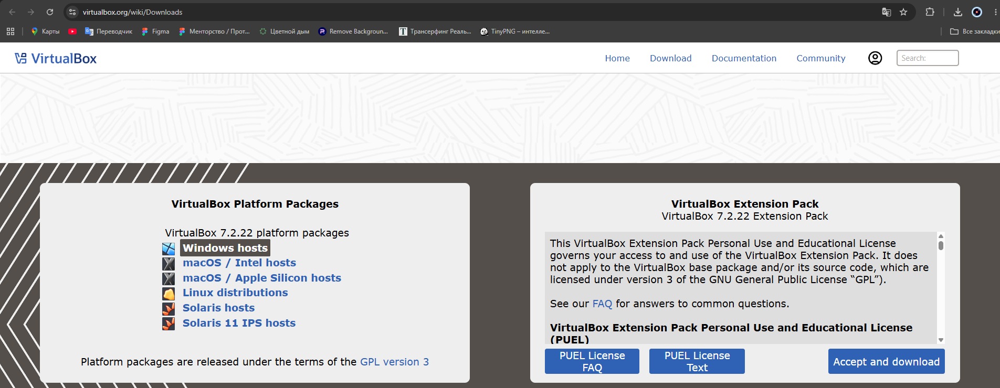

You only need **Windows hosts**. The Extension Pack on the right is not needed for anything in this document.

Why VirtualBox and not Hyper-V or VMware: it is free, works the same on Windows and Linux hosts, and its snapshot button is easy to find — which matters because the whole point of this machine is "try things without breaking anything".

## Step 2. Download the two installers (ISO files)

- **Ubuntu Server 26.04 LTS** — https://ubuntu.com/download/server → "Download Ubuntu Server 26.04 LTS".
- **Windows 11 Enterprise Evaluation** — https://www.microsoft.com/evalcenter → Windows 11 Enterprise → ISO, 64-bit.

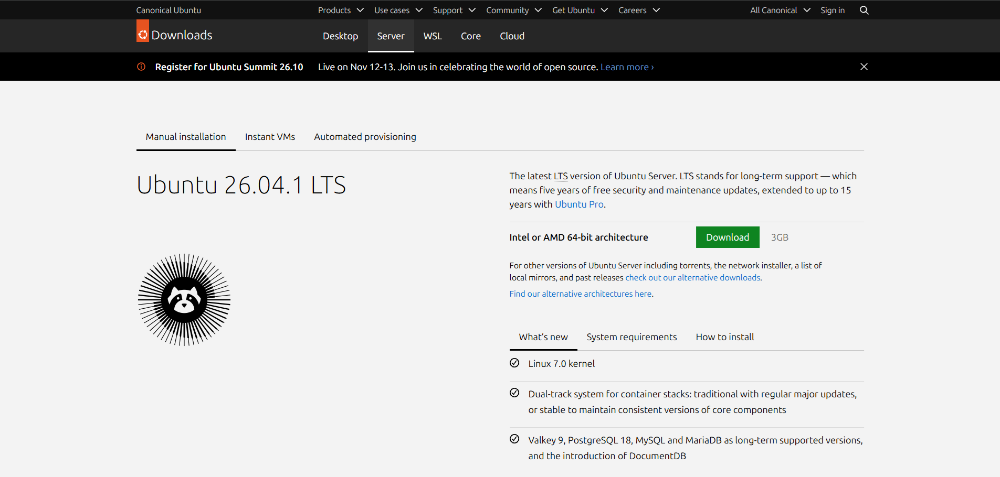

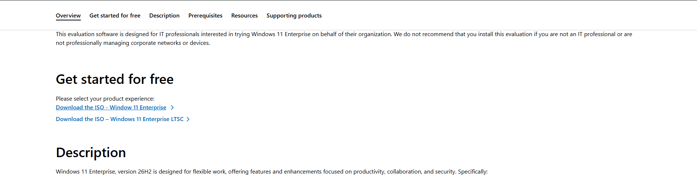

On the Microsoft page choose **Download the ISO – Windows 11 Enterprise** (not LTSC), then English, 64-bit. Save both in `Загрузки` (Downloads). Each is several GB.

Why these versions: "LTS" means Ubuntu supports it for 5 years, so it will not need replacing for the next developer. The Windows evaluation needs no licence key, which suits a test machine; it stops working after 90 days (see note at the end).

## Step 3. Create a shared network for the two machines

Menu **Файл → Инструменты → Сеть** (or press `Ctrl+H`).

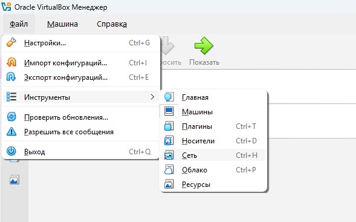

 The menu bar gets an extra item **Сеть**, and three tabs appear: **Виртуальные сети**, **Сети NAT**, **Облачные сети**.

Open **Сети NAT** → **Создать** (green plus). At the bottom, on the **Основные опции** tab:
- **Имя:** `NatNetwork`
- **IPv4 префикс:** `10.0.2.0/24`
- **Включить DHCP** — ticked
- **Включить IPv6** — leave unticked

→ **Применить**.

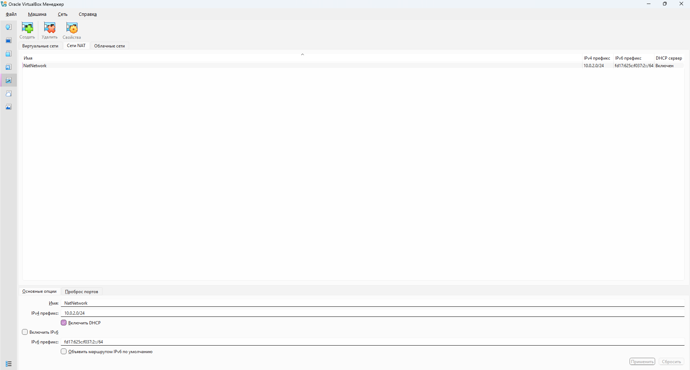

Why this and not plain NAT (the default): with plain NAT each machine gets internet but is alone in its own bubble — the two machines cannot see each other. A NAT Network puts them in one shared bubble that still reaches the internet through the host. Why not **Сетевой мост** (Bridged): on the Innotech network a bridged machine appears as a new device and is filtered; NAT Network avoids that. Why IPv6 off: nothing here needs it, and one address per machine is easier to read.

## Step 4. Create the Linux machine

Return to the machine list — **Файл → Инструменты → Машины** — and click **Создать** (blue star). One window opens, **Создать новую виртуальную машину**, made of sections you open by clicking their grey headers. Go through them top to bottom; click **Готово** only at the end.

**4a. Section «Имя и операционная система виртуальной машины»**
- **Имя ВМ:** `ubuntu-server`
- **Папка ВМ:** leave as is
- **Образ ISO:** click the arrow on the right → choose the Ubuntu file from Step 2. VirtualBox then fills in **ОС** `Linux`, **Дистрибутив ОС** `Ubuntu`, **Версия ОС** `Ubuntu (64-bit)` by itself.
- **Осуществить установку автоматически** — leave **unticked**

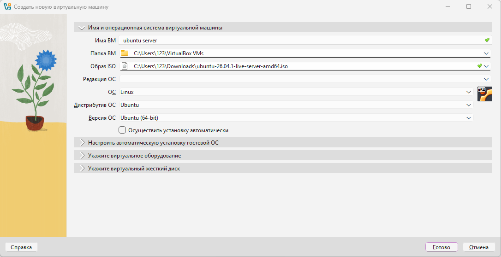

Why no automatic installation: it hides the choices and sometimes stops halfway with no explanation. Doing it by hand takes 5 more minutes but you see every step. Skip the section **Настроить автоматическую установку гостевой ОС** — it only matters if that box is ticked.

**4b. Section «Укажите виртуальное оборудование»**
- **Основная память:** `2048 МБ`
- **Число ЦПУ:** `2`
- **Использовать EFI** — unticked

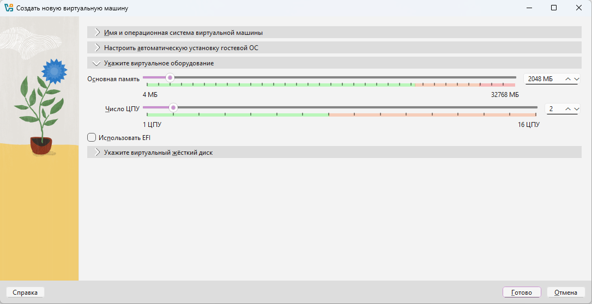

These are the values VirtualBox proposes for Ubuntu, and they are right: Ubuntu Server has no desktop and runs comfortably in 2 GB. Keep the slider in the green part of the scale — red means the real computer would be left short.

**4c. Section «Укажите виртуальный жёсткий диск»**
- **Создать новый виртуальный жёсткий диск** — selected
- **Размер диска:** `25,00 ГБ`
- Format **VDI (VirtualBox Disk Image)**
- **Выделить место в полном размере** — **unticked**

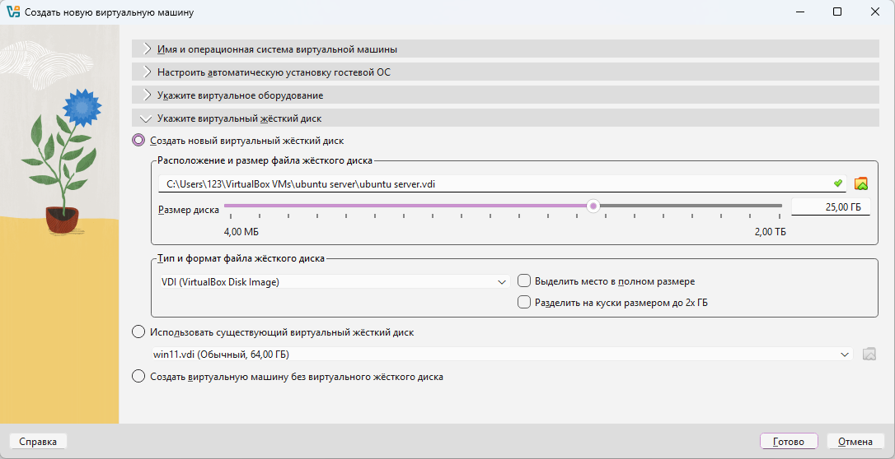

Why not pre-allocate: the disk file starts small and only grows as it is used, so 25 GB is a limit, not a cost (after installing Ubuntu the file is about 6.6 GB).

Click **Готово**. `ubuntu-server` appears in the list with status **Выключена**.

## Step 5. Connect the Linux machine to the shared network

Select `ubuntu-server` → **Настроить** (orange gear). At the top of the settings window switch from **Базовые** to **Расширенные** — in **Базовые** the network section is hidden. Then **Сеть** on the left → tab **Адаптер 1**:
- **Включить сетевой адаптер** — ticked
- **Тип подключения:** **Сеть NAT**
- **Имя:** **NatNetwork**

→ **OK**.

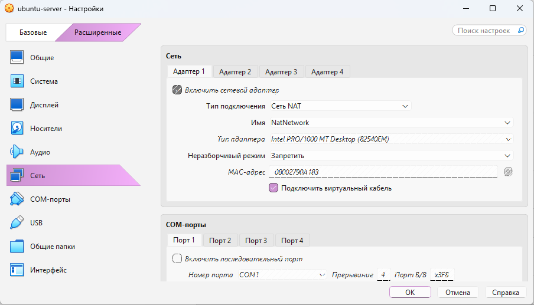

Why: this is what lets it see the Windows machine later (Step 3). If the **Имя** list is empty, Step 3 was not done — go back to it.

> **Check:** in the main window, right-hand panel, section **Сеть** now reads `Адаптер 1: Intel PRO/1000 MT Desktop (Сеть NAT, 'NatNetwork')`.

## Step 6. Install Ubuntu

Select `ubuntu-server` → **Запустить** (green arrow; while a machine is running the same button reads **Показать**). The Ubuntu installer is in English; use the keyboard (arrows, Enter, Space):

1. **Try or Install Ubuntu Server** → Enter.
2. Language: English. Keyboard: English (US). Type: **Ubuntu Server** (not minimized).
3. Network: you should see an address starting `10.0.2.` → Done. *If no address appears, Step 5 was not saved.*
4. Proxy: empty. Mirror: wait for the check to pass → Done.
5. Storage: **Use an entire disk** → Done → **Continue** (this only erases the virtual disk, not your real computer).
6. Profile: server name of your choice (I used `tima`), username of your choice (I used `tima`), a password you write down.
7. Ubuntu Pro: **Skip**. SSH: tick **Install OpenSSH server**. Featured snaps: select none.
8. Wait for **Reboot Now**. If it says "remove the installation medium", press Enter.

Why OpenSSH: lets the developer connect to this machine from a normal terminal and copy text out of it.

> **Check:** log in, run `ip addr` — you should see `inet 10.0.2.x`. Run `ping -c 4 8.8.8.8` — 4 replies.

## Step 7. Create the Windows machine

**Создать** → same window as Step 4:
- **Имя ВМ** `win11`, **Образ ISO**: the Windows file. **Осуществить установку автоматически** — unticked.
- **Укажите виртуальное оборудование:** VirtualBox proposes 4096 МБ and 2 ЦПУ — change them to **Основная память** `8192 МБ`, **Число ЦПУ** `4`. **Использовать EFI** is ticked automatically for Windows 11 — leave it.
- **Укажите виртуальный жёсткий диск:** VirtualBox proposes 80 ГБ — set `64,00 ГБ`, **Выделить место в полном размере** unticked.
- **Готово**.

VirtualBox also turns on **TPM 2.0** and **Безопасная загрузка** (Secure Boot) by itself — you can see them in the right-hand panel under **Система**. Do not change them.

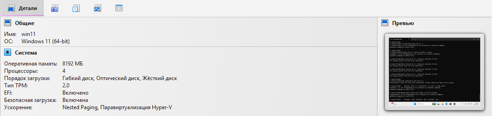

Why 8 GB and 4 CPUs: Windows 11 runs on 4 GB but becomes slow as soon as updates or a browser start; this host has 32 GB and 16 threads, so 8 GB and 4 cores still leave most of it free (see README). Why 64 GB: the minimum Windows 11 accepts. Why EFI/TPM/Secure Boot stay on: Windows 11 setup checks for them and stops with "This PC can't run Windows 11" otherwise.

Then **Настроить → Расширенные → Сеть → Адаптер 1 → Сеть NAT → NatNetwork → OK**, same as Step 5.

## Step 8. Install Windows

**Запустить**. When you see "Press any key to boot from CD", press a key immediately (if you miss it: close the window → **Выключить машину** → **Запустить** again).

1. Language → **Install now** → choose **Windows 11 Enterprise Evaluation** if asked.
2. Accept licence → **Custom: Install Windows only** → select the empty drive → **Next**. Wait ~20 min.
3. When asked how to set up: **Sign-in options → Domain join instead** → create a local user with a password.
4. Privacy questions: turn everything **off**.

Why a local account: a test machine should not be tied to someone's personal Microsoft account.

**Guest Additions** (screen resizes, mouse behaves, shared clipboard works): VirtualBox menu **Устройства → Подключить образ Дополнений гостевой ОС…** (in the menu of the running machine's window)

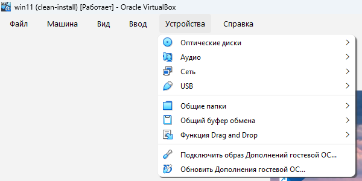

Then in Windows open **This PC → CD drive → VBoxWindowsAdditions** → Next to the end → reboot.

## Step 9. Let the machines answer each other

Windows blocks "ping" from other computers by default, so Linux cannot see it until you allow it. On top of that, Windows files the new virtual network under **Public** — its strictest profile.
In Windows: Start → type `powershell` → right-click **Run as administrator** → paste:

```powershell
New-NetFirewallRule -DisplayName "Allow ICMPv4 Echo In" -Protocol ICMPv4 -IcmpType 8 -Direction Inbound -Action Allow -Profile Any
```

Why only this rule and not "turn off the firewall": the firewall stays on for everything else; we open exactly one thing — incoming ping (ICMPv4 type 8). Why `-Profile Any`: the rule then works whether Windows calls this network Public or Private.

> **Check:**
> - Windows `cmd`: `ipconfig` → note the IPv4 address (`10.0.2.x`). `ping 8.8.8.8` and `ping <Ubuntu address>`.
> - Ubuntu: `ping -c 4 <Windows address>`.
> All show replies.

## Step 10. Take a "clean" snapshot of both machines

Shut both machines down properly (Ubuntu: `sudo poweroff`; Windows: Start → Shut down). Do **not** just close the window — the machine then shows **Прервана** and the snapshot would capture a half-crashed state.

Select `ubuntu-server` in the list → in the right-hand panel click the tab **Снимки** (second icon at the top of the panel). The toolbar changes and the menu bar gets an item **Снимок**. Click **Сделать** → name `clean-install` → **OK**. Repeat for `win11`.

The list on the left now shows the snapshot name in brackets next to each machine — `ubuntu-server (clean-install)`, `win11 (clean-install)` — so you can see at a glance that both are protected.

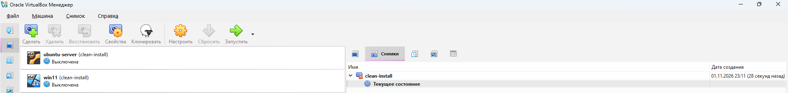

**This step is the answer to "so he can try things without breaking anything."** When a machine gets broken: power it off → tab **Снимки** → select `clean-install` → **Восстановить**. If VirtualBox offers to save the current (broken) state first, untick that unless you want to keep it. The machine is back to exactly this moment in about 10 seconds.

> **Check:** right after taking the snapshot, the line under it reads **Текущее состояние** with nothing after it. Once the machine is started and changed, it reads **Текущее состояние (изменено)** — that is how you can tell there is something to roll back.

---

## Notes for next time

- **Windows evaluation expires after 90 days.** After that, rebuild from Step 7, or buy a licence if the developer keeps using it.
- To make a third machine, repeat Steps 4–6 or 7–9 with a new name; it joins `NatNetwork` automatically.
